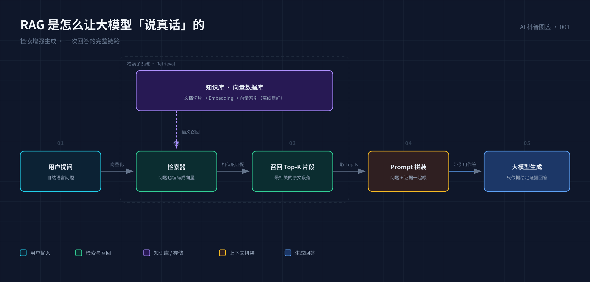
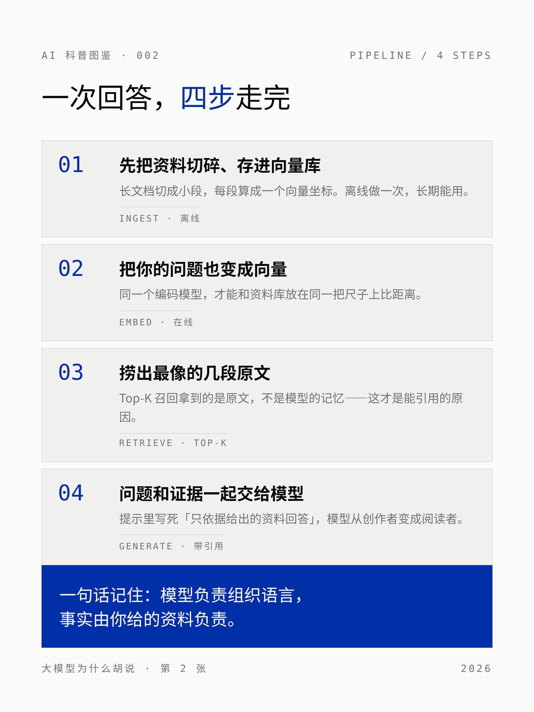

# AI 科普图文创作 · 纯代码渲染方案实测

> 目标：找到**不依赖任何图像生成 API / 模型接口**、只靠代码渲染就能批量产出 AI 科普图文的开源方案，
> 并逐个真实跑通、留下可复现的证据。
>
> 检索时间：2026-10-13 · 数据源：GitHub Search API + skillsmp / awesome-skills 等 skill 市场索引

---

## 一、结论速览

| # | 项目 | ⭐ | 最近提交 | 渲染方式 | 需要 API？ | 实测结论 |
|---|------|---|---------|---------|----------|---------|
| 1 | [cathrynlavery/diagram-design](https://github.com/cathrynlavery/diagram-design) | 53.7k | 2026-10-13 | 自包含 HTML + 内联 SVG | ❌ 不需要 | ✅ **最推荐**，编辑级质感，45 种图型 |
| 2 | [JimLiu/baoyu-skills](https://github.com/JimLiu/baoyu-skills) | 26.6k | 2026-09-10 | 手写 SVG → sharp 转 PNG | ❌ 不需要 | ✅ 深色科技风，自带转换脚本 |
| 3 | [markdown-viewer/skills](https://github.com/markdown-viewer/skills) | 3.4k | 2026-10-05 | Markdown 围栏 → infographic / echarts 引擎 | ❌ 不需要 | ✅ 最适合批量生产长文配图 |
| 4 | [op7418/guizang-social-card-skill](https://github.com/op7418/guizang-social-card-skill) | 7.5k | 2026-07-01 ⚠️ | HTML + CSS（Swiss / 杂志两套系统） | ❌ 不需要 | ✅ 小红书 3:4 卡片最成熟 |
| 5 | [joeseesun/qiaomu-info-card-designer](https://github.com/joeseesun/qiaomu-info-card-designer) | 272 | 2026-10-13 | HTML → 截图 → 智能分页 | ❌ 不需要 | ✅ 单张信息卡 + 自动切长图 |

**五个项目全部零 API、纯代码渲染，实测均能产出可发布的中文科普图。**
产出物在 [`runs/`](runs/)，项目源码在 [`projects/`](projects/)。

> ⚠️ **一处需要说明**：`guizang-social-card-skill` 最近一次提交是 2026-07-01，
> 比「近 3 个月」的窗口（≥ 2026-07-13）早约两周。其余 4 个项目均在窗口内。
> 它的替代候选见文末「备选清单」。

---

## 二、被排除的候选（重要）

搜索时命中了几个**看起来更对口、但其实要调图像模型**的项目，已经剔除：

| 项目 | 为什么不选 |
|---|---|
| `JimLiu/baoyu-skills` 里的 `baoyu-xhs-images` / `baoyu-infographic` / `baoyu-cover-image` | SKILL.md 明确要求走图像生成模型（`codex-imagegen` / nano-banana 一类）。**同仓库的 `baoyu-diagram` 才是纯代码渲染**，我们只采用了后者 |
| `ziguishian/MxPage`、`chubbyguan/chubbyskills`、`jogholy/xhs-publisher` | 需要自备模型 API Key / 依赖浏览器自动化发布 |
| `ziguishian/xhs-visual-director-skill`、`wenziai/wenzi-xiaohongshu-workflow` | 是「选题 + 提示词 + 视觉方案」的规划型 skill，本身不渲染图片 |
| `op7418/guizang-social-card-skill` 的 Live Photo 功能 | 该子功能需要用户自备视频素材 |

> 判断标准：**项目能否在没有任何模型 API、没有联网的情况下，仅靠 HTML/CSS/SVG + 引擎产出一张图。**

---

## 三、沙箱环境攻坚（这是本次最大的坑）

目标环境是一个**极简 Linux 容器**，开箱状态下和「浏览器渲染」这个词毫无关系：

| 缺什么 | 影响 | 解决方式 |
|---|---|---|
| 没有任何浏览器 | HTML → PNG 无从谈起 | npm 包 `@sparticuz/chromium` 把静态 Chromium 打进 tarball，从 registry.npmjs.org 直接取 |
| 缺 `libnspr4` / `libnss3` 等一堆 `.so` | Chromium 启动即 `error while loading shared libraries` | npm 包 `@achingbrain/nss` 打包了 `libnspr4.so`、`libnss3.so`…；`chrome-aws-lambda` 的 `bin/aws.tar.br` 里还有 Amazon Linux 版的 nss/sqlite/expat。两处凑齐 |
| **一个中文字体都没有** | 中文全部渲染成空白方块 | 从 `notofonts/noto-cjk` 做**稀疏检出**，只拉 `Sans/SubsetOTF/SC` 与 `Serif/SubsetOTF/SC`（每字重 ~8MB），放进 `~/.fonts`（在 `/etc/fonts/fonts.conf` 的默认扫描路径里） |
| 没有 `fc-cache` / `apt` 不可用 | 字体缓存无法刷新 | 不需要——fontconfig 会自行扫描 `~/.fonts` 并写缓存 |
| 系统 `ldconfig` 缓存为空 | 误判「库不存在」 | 用 `find` 直接查 `/usr/lib/x86_64-linux-gnu` |

一键重建环境：

```bash
bash setup/render-env.sh
# 产出： /tmp/render-env/{chromium,lib/*.so,node_modules}  +  ~/.fonts/NotoSansSC-*.otf
export LD_LIBRARY_PATH=/tmp/render-env/lib:$LD_LIBRARY_PATH
```

自检（会渲染一张中文测试图）：

```bash
node setup/shot.mjs --selftest
```

---

## 四、五个 Run 的实测产出

每个 Run 的目录里都有：源文件、产出的 PNG、以及一份说明「用了项目里的哪套规范、踩了什么坑」的 README。

### Run 1 · baoyu-diagram — 深色科技风系统图



- **按项目规范手写 SVG**：`#0f172a` 底 + 40px 网格、语义色板（cyan/emerald/violet/amber/blue）、
  "先画线 → 再画不透明遮罩 → 最后画组件"的层级技巧、viewBox 四周留 30px。
- **用项目自带的 `scripts/main.ts` 转 PNG**（源码零改动，用 `tsx` 执行），走 sharp/librsvg。
- 坑：`JetBrains Mono` 不在沙箱里，中文字形由 Noto Sans SC 兜底；`rgba()` 半透明填充必须靠遮罩层挡线，否则箭头会穿透方块。

### Run 2 · guizang — 小红书 3:4 卡片组

 

- 严格套用它的 **Swiss International** 系统：`1080×1440`、安全边距 72–96px、
  token 层（`--paper / --ink / --accent`）、**"越大越轻"** 的字重映射（hero 236px/weight 200、正文 24–26px/weight 400）、
  mono 20px 宽字距 meta 条。
- 布局配方：封面用 `S01 Accent Cover`（大字 + 双节点系统图 + 底部 metadata strip），内页用 `S06 Pipeline`（发丝边框 + 中性灰底的三段流水线）。
- 坑：原模板从 Google Fonts 和 unpkg 拉 Inter / Noto Sans SC / lucide —— 沙箱不可达。已全部本地化：
  字体走本机 Noto Sans SC，图标改纯 CSS 几何。**这是唯一必要的偏离，其余规范原样保留。**

### Run 3 · documd — Markdown 围栏直接出图


- 一篇 Markdown 里同时用 ```` ```infographic ````（AntV Infographic 引擎，113 个模板）和 ```` ```echarts ````，
  一条命令导出全部图表：

  ```bash
  npx documd runs/03-documd/article.md --assets ./figures --chrome /tmp/chromium
  ```

- 坑 1：默认深色皮肤，`colorBg` 是 DSL 里唯一能改背景的键；但 **`colorText` 等键会被判语法错误**，文字色只能交给引擎。
- 坑 2：`compare-*` 系列模板对中文小标题不友好（会把首字放大成巨型卡片，`desc` 直接丢失）→ 换成 `hierarchy-tree`。
- 坑 3：ECharts 里的中文**必须显式声明 `textStyle.fontFamily`**，否则整段中文渲染为空白。

### Run 4 · qiaomu — 杂志质感信息卡 + 自动分页


- 套用它的卡片规范：`600px` 宽卡（2x 截图 = 1200px，手机上近 1:1）、
  主标题 56px、条目标题 28px、正文 20px、标签 16px，奶油底 `#f5f3ed` + 藏青强调色 `#2c3e8c`。
- **用项目自带的 `scripts/split_card.py` 把 1200×2626 的长图在自然断点切成 3 张**：
  脚本不硬切，而是找「整行都是背景色」的空白带作为切点，保证不切断文字。
- 坑：它的设计规范指定本地的 **仓耳今楷02（19MB TTF）**，体积不适合入仓；改用 Noto Serif SC 保持同一视觉家族。

### Run 5 · diagram-design — 编辑级 SVG（最高星项目）


- 用它的 **token 层**（`paper #f5f5f5` / `ink #2d3142` / `muted #4f5d75` / `accent #bf4520`）而不是硬编十六进制，
  尺寸取 `doc-inline` 预设 `0 0 960 600`（所有坐标都是 4 的倍数），文件结构按 `html → 导出 svg/png` 的正规路径。
- **用项目自带的 `scripts/export_svg.py` 导出独立 SVG**（`--system-fonts` 跳过 Google Fonts 请求），得到矢量可编辑版本。
- 坑：Geist 无中文字形，按 `output-spec.md` §「Non-Latin labels」的要求，在 `<text>` 上把字体族扩展为 `'Geist','Noto Sans SC'`，而不是换掉整套 skin。

---

## 五、复现全部产出

```bash
# 0) 准备渲染环境（只需一次）
bash setup/render-env.sh
export LD_LIBRARY_PATH=/tmp/render-env/lib:$LD_LIBRARY_PATH
export RENDER_HOME=/tmp/render-env

# 1) baoyu-diagram：SVG → PNG（项目自带脚本）
cd projects/baoyu-skills/skills/baoyu-diagram
npx -y tsx scripts/main.ts ../../../../runs/01-baoyu-diagram/rag.svg \
  -o ../../../../runs/01-baoyu-diagram/rag@2x.png
cd -

# 2) guizang：卡片截图（通用渲染器，按 1080×1440 / 2x）
node setup/shot.mjs runs/02-guizang/xhs-01-cover.html    runs/02-guizang/xhs-01-cover.png    --width=1080 --height=1440 --dpr=2
node setup/shot.mjs runs/02-guizang/xhs-02-pipeline.html runs/02-guizang/xhs-02-pipeline.png --width=1080 --height=1440 --dpr=2

# 3) documd：Markdown → 全部图表 + 长图 + HTML
npm i @markdown-viewer/documd
npx documd runs/03-documd/article.md --assets runs/03-documd/figures --chrome /tmp/chromium
npx documd runs/03-documd/article.md runs/03-documd/article-full.png --format png --chrome /tmp/chromium

# 4) qiaomu：信息卡截图 + 项目自带脚本智能分页
node setup/shot.mjs runs/04-qiaomu/info-card.html runs/04-qiaomu/info-card.png \
  --width=600 --height=1400 --dpr=2 --selector=.card
python3 projects/qiaomu-info-card-designer/scripts/split_card.py runs/04-qiaomu/info-card.png 1200 1400

# 5) diagram-design：HTML → PNG + 独立 SVG（项目自带导出脚本）
node setup/shot.mjs runs/05-diagram-design/attention.html runs/05-diagram-design/attention.png \
  --width=1024 --height=1200 --dpr=2 --selector=.frame
python3 projects/diagram-design/skills/diagram-design/scripts/export_svg.py \
  runs/05-diagram-design/attention.html runs/05-diagram-design/attention.svg --system-fonts
```

---

## 六、怎么选

| 你的场景 | 用哪个 |
|---|---|
| 要**一张能发公众号 / 博客的技术解释图**，追求质感 | `diagram-design`（编辑级 SVG，可再编辑） |
| 要**一整套小红书轮播**（封面 + 内页 + 统一视觉） | `guizang-social-card-skill` |
| 要**给长文批量配图**，图和文一起版本管理 | `markdown-viewer/skills`（documd） |
| 要**单张高信息密度信息卡**，还要自动切长图 | `qiaomu-info-card-designer` |
| 要**深色科技风的系统 / 流程 / 架构图** | `baoyu-diagram` |

**组合打法推荐**：`diagram-design` 出主视觉 → `documd` 出文中所有配图 → `guizang` 出社交平台投放版本。
三者都是 HTML/Markdown 源码形态，天然适合进 Git 做版本管理，也适合挂进 CI 自动出图。

---

## 七、备选清单（发布时可选）

| 项目 | ⭐ | 最近提交 | 说明 |
|---|---|---|---|
| `fxyadela/write-then-publish` | 569 | 2026-10-04 | 本地优先，Markdown → 小红书图文 + 公众号长文 + 可下载图片，支持 Obsidian。**窗口内**，但交互式 Web 应用，需登录云服务才能跑完整导出 |
| `pangxiaobin/MarkCardStudio` | 306 | 2026-08-30 | Vue3 + Tauri 桌面端，Markdown → 卡片/PDF，16 套主题 + KaTeX + Mermaid，窗口内 |
| `dososo/blcaptain-style-skill` | 167 | 2026-07-08 | 中文图文卡片 skill，3 套视觉语言（静纸 / 实证 / 图桥），略超窗口 |
| `ziguishian/xhs-visual-director-skill` | 1.4k | 2026-07-03 | 小红书「视觉导演」，只做规划不渲染，略超窗口 |

---

## 八、目录结构

```
├── README.md                 ← 你在这里
├── setup/
│   ├── render-env.sh         一键重建「无浏览器 / 无中文字体」环境
│   └── shot.mjs              通用 HTML → PNG 渲染器（含中文字体内联）
├── runs/                     五个项目的实测产出（源文件 + PNG + 说明）
│   ├── 01-baoyu-diagram/
│   ├── 02-guizang/
│   ├── 03-documd/
│   ├── 04-qiaomu/
│   └── 05-diagram-design/
└── projects/                 精简搬运的上游项目源码（见 projects/README.md 的许可说明）
```

---

## 九、版权

`projects/` 下是上游项目的**精简副本**（去掉大体积截图与演示资源，保留源码、规范与许可证），
版权归各原作者所有，许可证详见 [`projects/README.md`](projects/README.md)：

- diagram-design — MIT · baoyu-skills — MIT · qiaomu-info-card-designer — MIT
- guizang-social-card-skill — AGPL-3.0 · markdown-viewer/skills — CC-BY-4.0

`setup/` 与 `runs/` 为本次实测产物，可自由取用。
