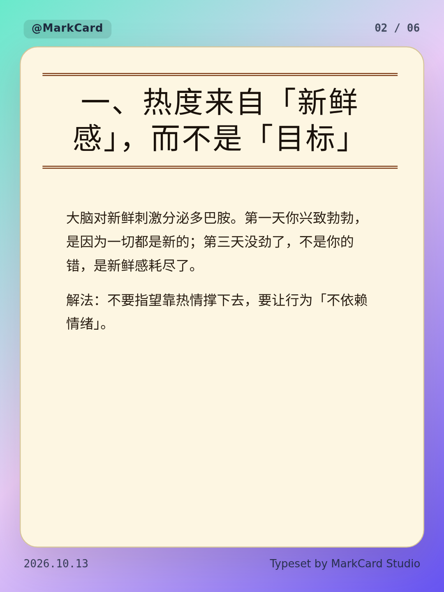
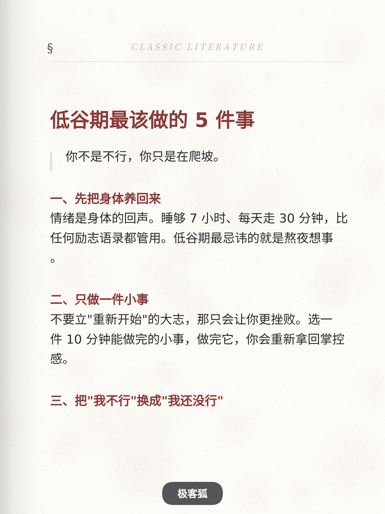
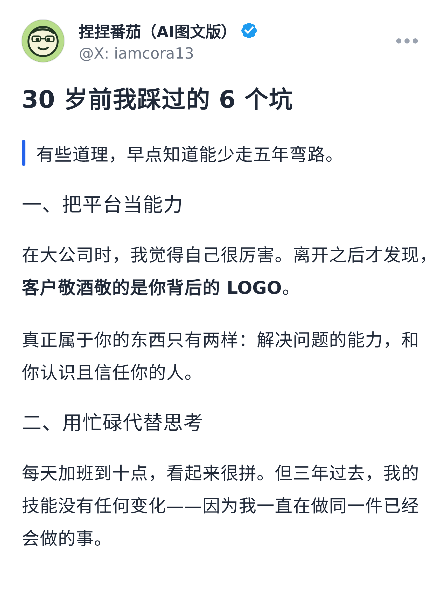
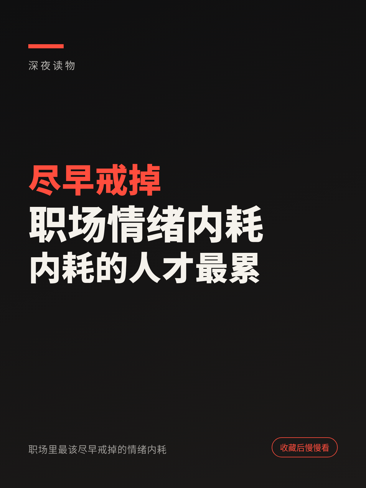

# AI 鸡汤图文 / 涨粉图文 · 代码渲染实测仓库

把 GitHub 与 skill 市场上「**能批量产出图文内容**」的开源项目拉进来，**一个个真跑**，把成品图直接放进仓库。
选品硬条件：**不需要 API Key**、**代码渲染**、**近 3 个月有更新**、**star 尽量高**。

> 关于生图：用户的要求是「要模型生图，但把生图那步换成 **Arena 的生图**」。
> 所以：本地渲染类项目直接跑（Run 01–05）；生图类技能只保留它的提示词/风格库，出图交给 Arena（Run 06）。

## 结论速览

| Run | 项目（star） | 一句话 | 产出 | 状态 |
|---|---|---|---:|---|
| [01](runs/01-xhs-textcard) | [XHS-TextCard](https://github.com/geekfoxcharlie/XHS-TextCard)（107★） | Markdown → 小红书竖版卡片，纯前端 Canvas，12 套模板 | 12 张 1242×1656 | ✅ |
| [02](runs/02-markcardstudio) | [MarkCard Studio](https://github.com/pangxiaobin/MarkCardStudio)（306★） | Vue3 + Tauri 桌面级排版，16 套主题，智能分页 | 24 张 1080×1440 | ✅ |
| [03](runs/03-article-tools) | [article-tools](https://github.com/eternityspring/article-tools)（825★） | 公众号封面生成器，多配色/装饰/字体 | 3 张 1808×724 | ✅ |
| [04](runs/04-write-then-publish) | [写了就发](https://github.com/fxyadela/write-then-publish)（569★） | 一份 Markdown → 图文卡片 + 公众号长图 | 3 张卡片 + 1 张长图 | ✅ |
| [05](runs/05-ah-xhs-cover-title) | [ah-xhs-cover-title](https://github.com/ahang008/ah-xhs-cover-title)（179★） | 85 条爆款公式库 → 封面三行 + 代码渲染封面 | 4 张 1242×1656 | ✅ |
| [06](runs/06-arena-imagegen) | [qiaomu-codex-imagegen](https://github.com/joeseesun/qiaomu-codex-imagegen)（131★） | 风格库编排提示词 → **Arena 生图** → 代码叠字 | 3 张 1242×1656 | ✅ |

**6 个全部实跑出成品**，共 47 张成品图。全部零外部 API（Run 06 的生图由 Arena 提供）。

## 成品预览

| 鸡汤长卡片（Run 02 · 复古报刊） | 小红书卡片（Run 01 · 书页模板） |
|---|---|
|  |  |

| 公众号封面（Run 03 · 午夜） | 模型生图 + 代码叠字（Run 06） |
|---|---|
|  |  |

| 图文卡片（Run 04 · 1728×2304） | 爆款公式封面（Run 05） |
|---|---|
|  |  |

## 目录结构

```
projects/          6 个 vendor 进来的上游源码（只改「取依赖」，不改渲染逻辑）
runs/01..06/       每个项目一个 run：run.mjs（驱动脚本）+ content.md（素材）+ out/（成品）
tools/browser.mjs  共用浏览器驱动层（静态服务 / Chromium 启动 / dataURL 落盘）
archive/           上一轮（图文卡片向）的成果，已归档，不再改动
```

## 怎么复现

```bash
# 1) 一次性：搭渲染环境（Chromium + 私有 so + 中文字体），幂等
bash archive/setup/render-env.sh
export LD_LIBRARY_PATH=/tmp/render-env/lib:$LD_LIBRARY_PATH

# 2) 逐个跑（每个都会把成品写进 runs/<n>/out/）
node runs/01-xhs-textcard/run.mjs
node runs/02-markcardstudio/run.mjs        # 需先 cd projects/MarkCardStudio && npm i && npx vite build
node runs/03-article-tools/run.mjs
node runs/04-write-then-publish/run.mjs
node runs/05-ah-xhs-cover-title/run.mjs
node runs/06-arena-imagegen/run.mjs        # 底图用 assets/ 里 Arena 生成的结果
```

## 沙箱里踩到的坑（都已解决，记下来省得再踩）

| 现象 | 原因 | 解法 |
|---|---|---|
| npm 报 `UNABLE_TO_VERIFY_LEAF_SIGNATURE` | 出网走代理，Node 不认它的证书链 | `npm config set strict-ssl false` |
| 浏览器起不来 / `libnspr4.so` 缺失 | 沙箱没有系统 Chromium 与 NSS | `@sparticuz/chromium` + `@achingbrain/nss`，见 `archive/setup/render-env.sh` |
| 中文渲染成方块 | 系统无 CJK 字体 | 稀疏检出 `notofonts/noto-cjk` 到 `~/.fonts` |
| 页面里的 CDN 脚本静默 404 | 沙箱没有 jsDelivr / Google Fonts 的访问权 | 把依赖 vendored 到各项目内（见 `projects/README.md`） |
| 卡片导出为空 | 应用自己的「示例项目」是只读的，会拦截下载 | 先点「+ 新建」建自己的项目再灌内容（`runs/04` 脚本已处理） |
| 主题设置不生效 | 该应用的主题名是**配置里的中文名**，界面显示的是 i18n 英文名 | 写 localStorage 时用中文名，见 `runs/02` 脚本 |
| 页面里有 `beforeunload`，`page.reload()` 会挂 | 浏览器弹确认框、导航被拦 | 用 `Promise.all([waitForNavigation, evaluate(()=>location.reload())])` 并自动 accept dialog |
| 长图输出很窄（518px） | 导出按侧栏预览宽度截图 | 注入 `<style>` 覆盖 `.article-preview` 宽度到 750px |

## 说明

- 所有项目版权归原作者所有，`projects/<name>/LICENSE` 为原始许可证；`write-then-publish` 为**个人非商业**许可，`MarkCardStudio` 为 GPL-3.0。
- `archive/` 存放已完成、不再改动的历史轮次：
  - `archive/` 根目录 = 「AI 科普图文 · 纯代码渲染」那一轮（信息图 / 卡片 / 长图 / 动图，含 `localimage/` 本地渲染服务）
  - `archive/round2-infographics/` = 同轮次的 5 个 vendor 项目与 6 个 run 的完整现场
- 生成时间：2026-10-13/14。
