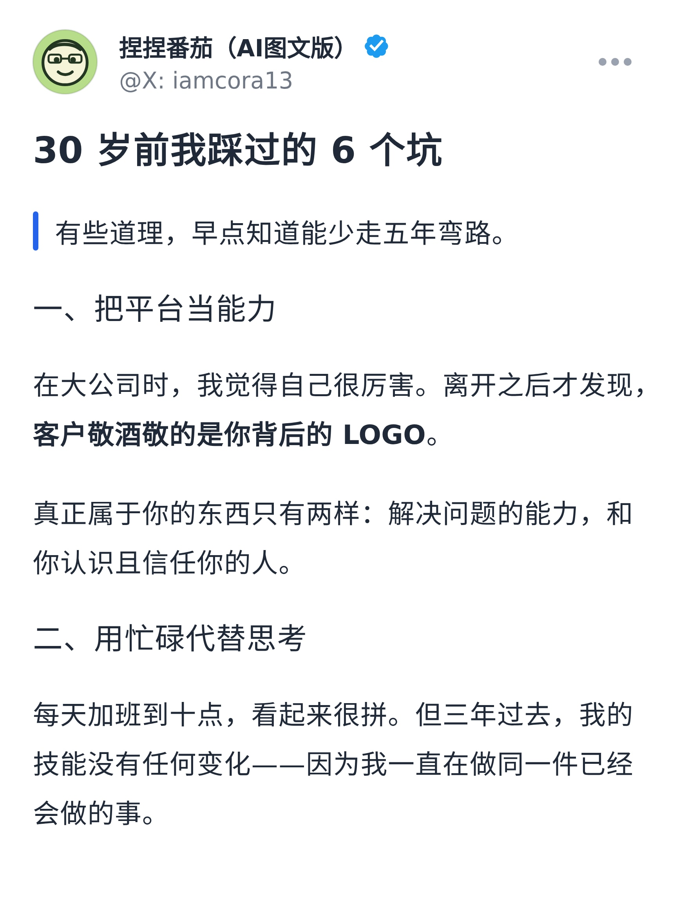
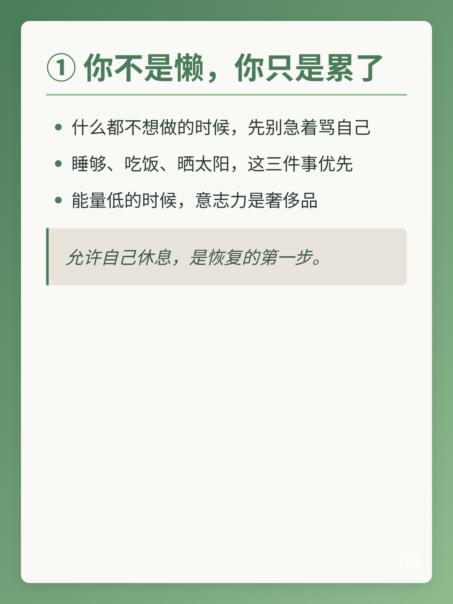
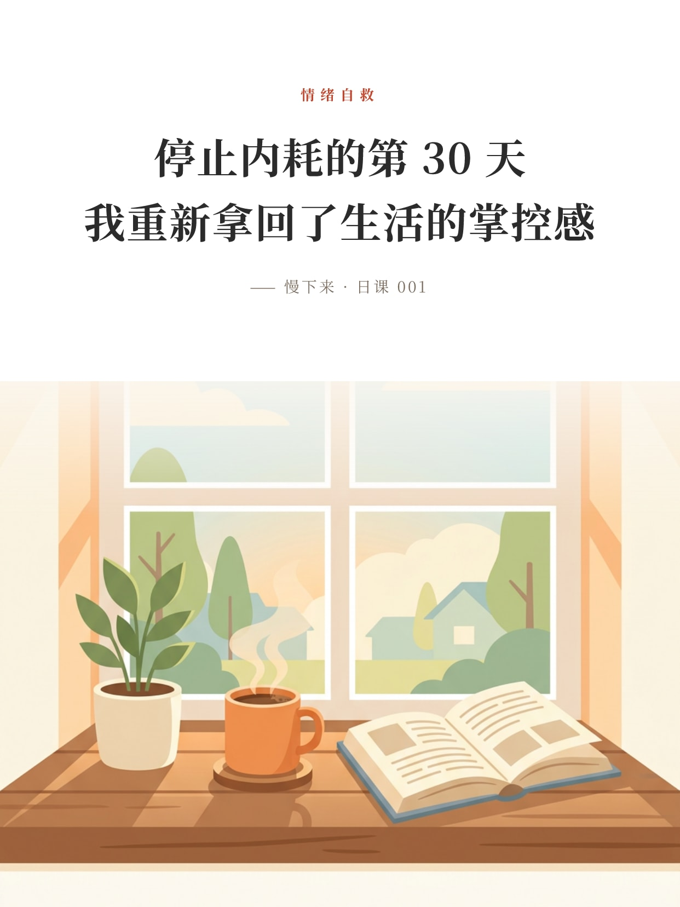
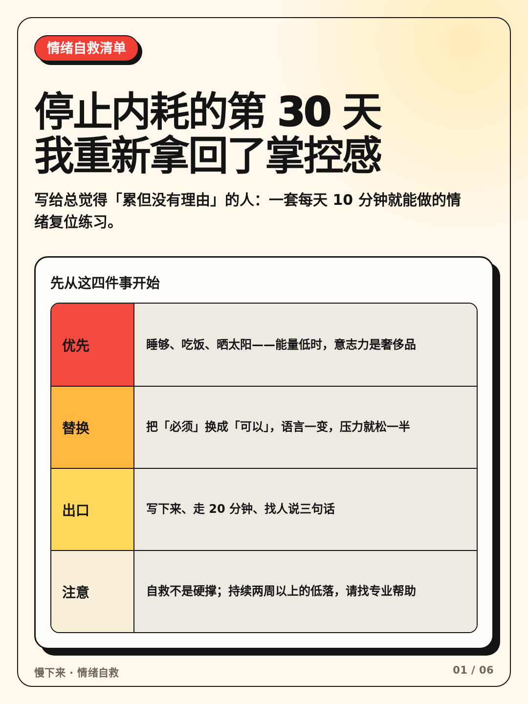
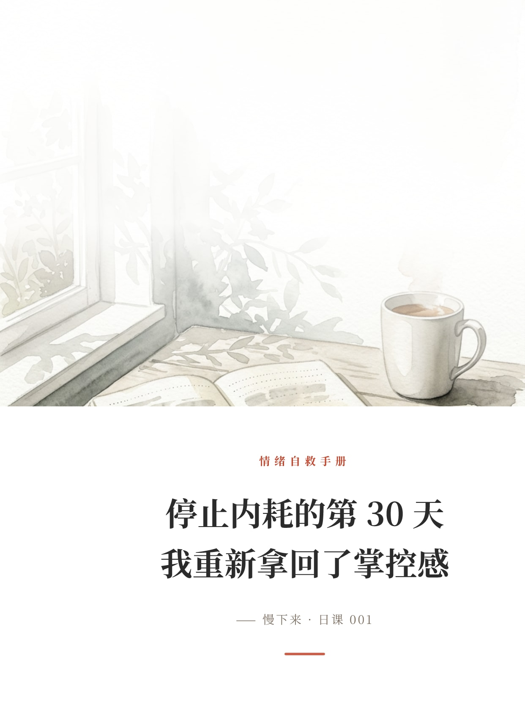

# AI 鸡汤图文 / 涨粉图文 · 代码渲染实测仓库

把 GitHub 与 skill 市场上「**能批量产出图文内容**」的开源项目拉进来，**一个个真跑**，把成品图直接放进仓库。
选品硬条件：**不需要 API Key**、**代码渲染**、**近 3 个月有更新**、**star 尽量高**。

> 关于生图：用户的要求是「要模型生图，但把生图那一步换成 **Arena 的生图**」。
> 所以：本地渲染类项目直接跑；生图类技能只保留它的提示词/风格库，出图交给 Arena，
> 再用代码把文字层叠上去。**运行期零外部图像 / 大模型 API。**

本仓库由两轮实测合并而成：**Run 01–06**（第一批选品）与 **Run 07–12**（第二批选品，star 更高、覆盖纯代码渲染的不同技术栈）。
两批共 **12 个项目全部实跑出成品**，画廊：`runs/gallery.html`。

## 结论速览 · Run 01–06

| Run | 项目（star） | 一句话 | 产出 | 状态 |
|---|---|---|---:|---|
| [01](runs/01-xhs-textcard) | [XHS-TextCard](https://github.com/geekfoxcharlie/XHS-TextCard)（107★） | Markdown → 小红书竖版卡片，纯前端 Canvas，12 套模板 | 12 张 1242×1656 | ✅ |
| [02](runs/02-markcardstudio) | [MarkCard Studio](https://github.com/pangxiaobin/MarkCardStudio)（306★） | Vue3 + Tauri 桌面级排版，16 套主题，智能分页 | 24 张 1080×1440 | ✅ |
| [03](runs/03-article-tools) | [article-tools](https://github.com/eternityspring/article-tools)（825★） | 公众号封面生成器，多配色/装饰/字体 | 3 张 1808×724 | ✅ |
| [04](runs/04-write-then-publish) | [写了就发](https://github.com/fxyadela/write-then-publish)（569★） | 一份 Markdown → 图文卡片 + 公众号长图 | 3 张卡片 + 1 张长图 | ✅ |
| [05](runs/05-ah-xhs-cover-title) | [ah-xhs-cover-title](https://github.com/ahang008/ah-xhs-cover-title)（179★） | 85 条爆款公式库 → 封面三行 + 代码渲染封面 | 4 张 1242×1656 | ✅ |
| [06](runs/06-arena-imagegen) | [qiaomu-codex-imagegen](https://github.com/joeseesun/qiaomu-codex-imagegen)（131★） | 风格库编排提示词 → **Arena 生图** → 代码叠字 | 3 张 1242×1656 | ✅ |

## 结论速览 · Run 07–12（第二批，star 更高 / 技术栈更硬）

| Run | 项目（star） | 一句话 | 产出 | 状态 |
|---|---|---|---:|---|
| [07](runs/07-auto-redbook-skills) | [Auto-Redbook-Skills](https://github.com/comeonzhj/Auto-Redbook-Skills)（**2358★**） | Skill + 渲染脚本，8 主题 × 4 种分页模式 | 4 套主题 × 6 张，1080×1440 / 2160×2880 | ✅ |
| [08](runs/08-xhs-textcard) | [XHS-TextCard](https://github.com/geekfoxcharlie/XHS-TextCard)（107★） | 同一项目的**无头驱动**：选模板 → 分页 → 高清导出，封面换 Arena 生图 | 3 套模板，1242×1656 | ✅ |
| [09](runs/09-markcard-studio) | [MarkCard Studio](https://github.com/pangxiaobin/MarkCardStudio)（306★） | 驱动真实 UI「Export PNG set」批量导出 | 2 套主题 × 6 张，1080×1440 | ✅ |
| [10](runs/10-takumi) | [takumi](https://github.com/kane50613/takumi)（**3098★**） | Rust + JSX/HTML → PNG/**GIF**，**不需要浏览器** | 6 张金句卡 1242×1656 + 动态 GIF 封面 | ✅ |
| [11](runs/11-xiaohongshu-article-cards) | [xiaohongshu-article-cards](https://github.com/qianjiazheng2023/xiaohongshu-article-cards)（37★） | Skill + 4 套卡片模板 + 布局验收脚本 | 奶油信息卡 6 张轮播，1080×1440 | ✅ |
| [12](runs/12-satori) | [vercel/satori](https://github.com/vercel/satori)（**14068★**） | HTML/CSS → SVG → PNG（Vercel OG 的底座） | 4 张金句卡，1242×1656 | ✅ |

**12 个全部实跑出成品。** Run 08 / 10 / 12 的封面与底图由 **Arena 生图**提供（`runs/assets/arena/`），
其余全部零外部 API。

## 成品预览

| 鸡汤长卡片（Run 02 · 复古报刊） | 小红书卡片（Run 01 · 书页模板） |
|---|---|
|  |  |

| 公众号封面（Run 03 · 午夜） | 模型生图 + 代码叠字（Run 06） |
|---|---|
|  |  |

| 图文卡片（Run 04 · 1728×2304） | 爆款公式封面（Run 05） |
|---|---|
|  |  |

| 多主题卡片（Run 07 · 植物园主题） | 金句卡 + Arena 生图底图（Run 10 · takumi） |
|---|---|
|  |  |

| 信息卡轮播（Run 11 · 奶油编辑风） | HTML/CSS → PNG（Run 12 · satori） |
|---|---|
|  |  |

> 更多成品见 `runs/gallery.html`（76 张，`npm run gallery` 可重新生成）。

## 目录结构

```
projects/              11 个 vendor 进来的上游源码（只改「取依赖」，不改渲染逻辑）
runs/01..06/           第一批：每个项目一个 run（run.mjs + content.md + out/）
runs/07..12/           第二批：每个项目一个 run（驱动脚本 + 复现说明 + 成品）
runs/assets/arena/     第二批用到的 Arena 生图素材（5 张治愈系插画，留了文字安全区）
runs/gallery.html      静态画廊（npm run gallery 生成）
tools/browser.mjs      第一批的共用浏览器驱动层（静态服务 / Chromium 启动 / dataURL 落盘）
setup/                 第二批的共用工具：local-browser.sh、local-chromium.cjs、satori-cards.mjs、
                       build-gallery.mjs、optimize-images.mjs、preview-server.mjs
archive/               更早一轮（图文卡片向）的成果，已归档，不再改动
```

## 怎么复现

```bash
# 1) 一次性：搭渲染环境（Chromium + 私有 so + 中文字体），幂等
bash archive/setup/render-env.sh
bash setup/local-browser.sh                     # 让 playwright 直接复用上面的 Chromium
export LD_LIBRARY_PATH=/tmp/render-env/lib:$LD_LIBRARY_PATH
npm i                                           # 根依赖：playwright / sharp / satori / resvg / takumi-js

# 2) 第一批（Run 01–06）
npm run run:01
npm run run:02        # 需先 cd projects/MarkCardStudio && npm i && npx vite build
npm run run:03
npm run run:04
npm run run:05
npm run run:06        # 底图来自 runs/06-arena-imagegen/assets（Arena 生图结果）

# 3) 第二批（Run 07–12）
npm run run:07        # Auto-Redbook-Skills：8 主题任选，-t/-m/--dpr 直接调
npm run run:08        # XHS-TextCard 无头驱动（--cover 传 Arena 生图当封面）
npm run dev:markcard & npm run run:09   # MarkCard Studio：起 dev server 后驱动真实「Export PNG set」
npm run run:10        # takumi：金句卡 + GIF 动图封面，全程无浏览器
npm run run:11        # 小红书轮播卡片 Skill（填内容 → 上游渲染脚本出图）
npm run run:12        # satori：HTML/CSS → SVG → PNG

# 4) 看成品
npm run gallery && npm run preview      # 打开 /runs/gallery.html
```

## 关于「生图 API」的处理（本仓库的硬约定）

| 位置 | 接法 | 落地案例 |
|------|------|---------|
| 封面 / 底图 | Arena 生图产物放进 `runs/assets/arena/`，以 **dataURL 注入项目的原生字段**（`coverImage` / `bg`），文字与排版仍由代码完成 | Run 08（换掉模板自带封面）、Run 10（图卡主题）、Run 12（上半版大图） |
| 提示词 | 生图类 skill 只保留**提示词/风格库**（如 `qiaomu-codex-imagegen` 的 `suggest`/`compose`），出图交给 Arena | Run 06、Run 05（爆款公式 → 封面三行） |
| 动态封面 | takumi 直接渲染 GIF/动画 WebP，底图同样来自 Arena | Run 10 `cover-animated.gif` |

**没有任何项目在运行期调用第三方图像 / 大模型 API**；第二批的 `takumi`、`satori` 连浏览器都不需要。

## 实测环境与体积说明

- 沙箱：Linux x64、Node 22、Python 3.11；**无浏览器、无中文字体**（用 `archive/setup/render-env.sh` 补齐）。
- 中文渲染统一使用 `~/.fonts` 的 Noto Sans / Serif SC。
- 第二批成品图中大于 320KB 的按 `npm run optimize` 转为 **JPEG q90**（小红书等平台本身会二次压缩），
  需要无损 PNG 时按各 `runs/*/README.md` 的命令重跑即可。
- `projects/**/node_modules`、构建产物不入库。
