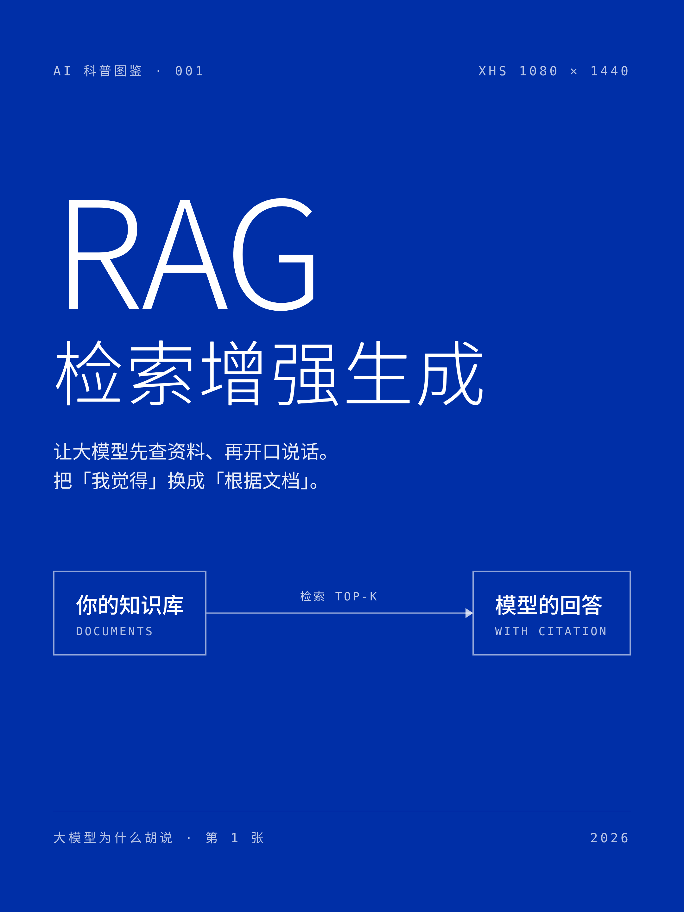
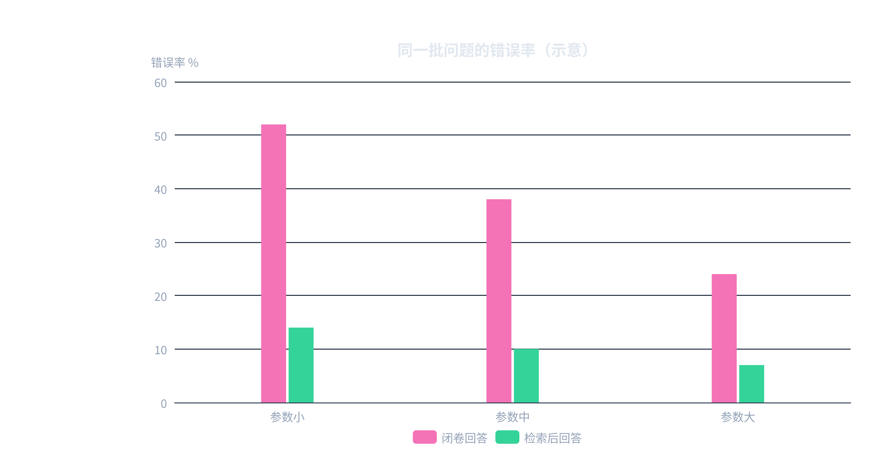
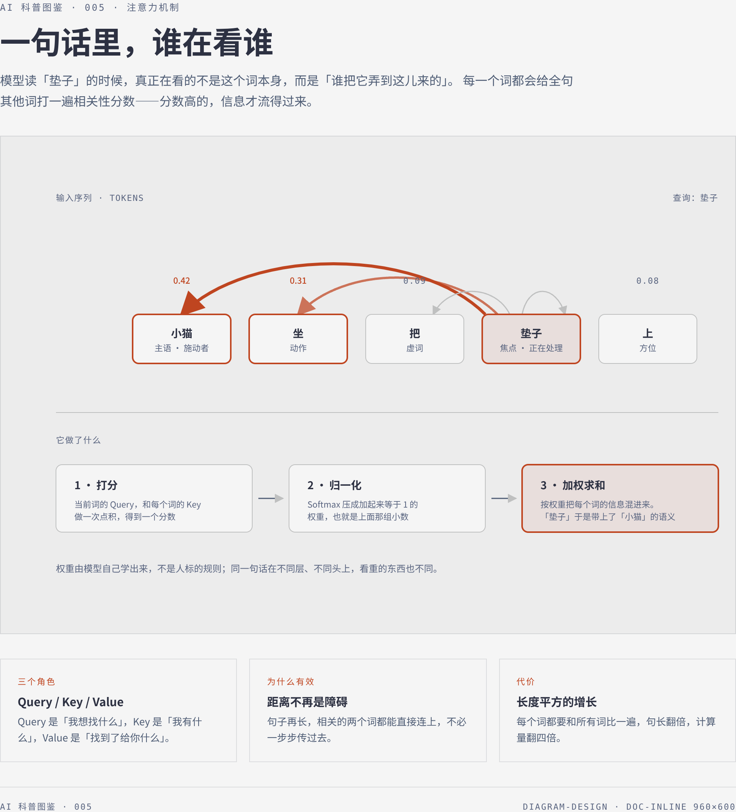
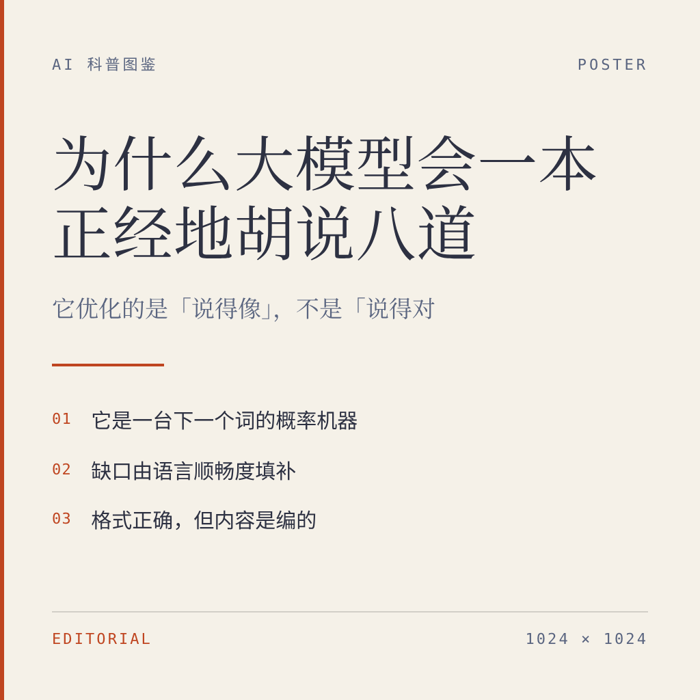
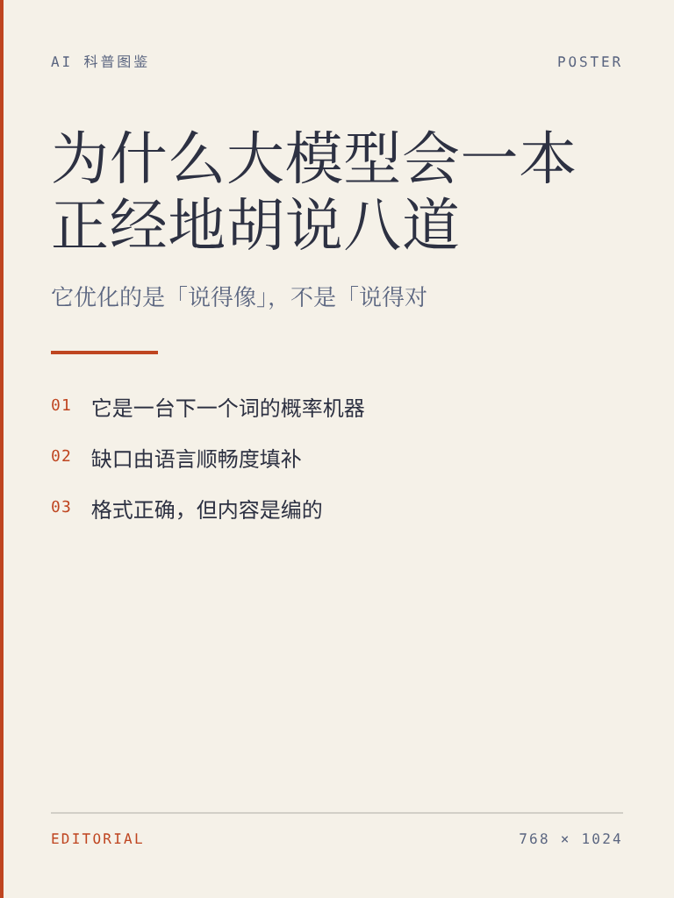
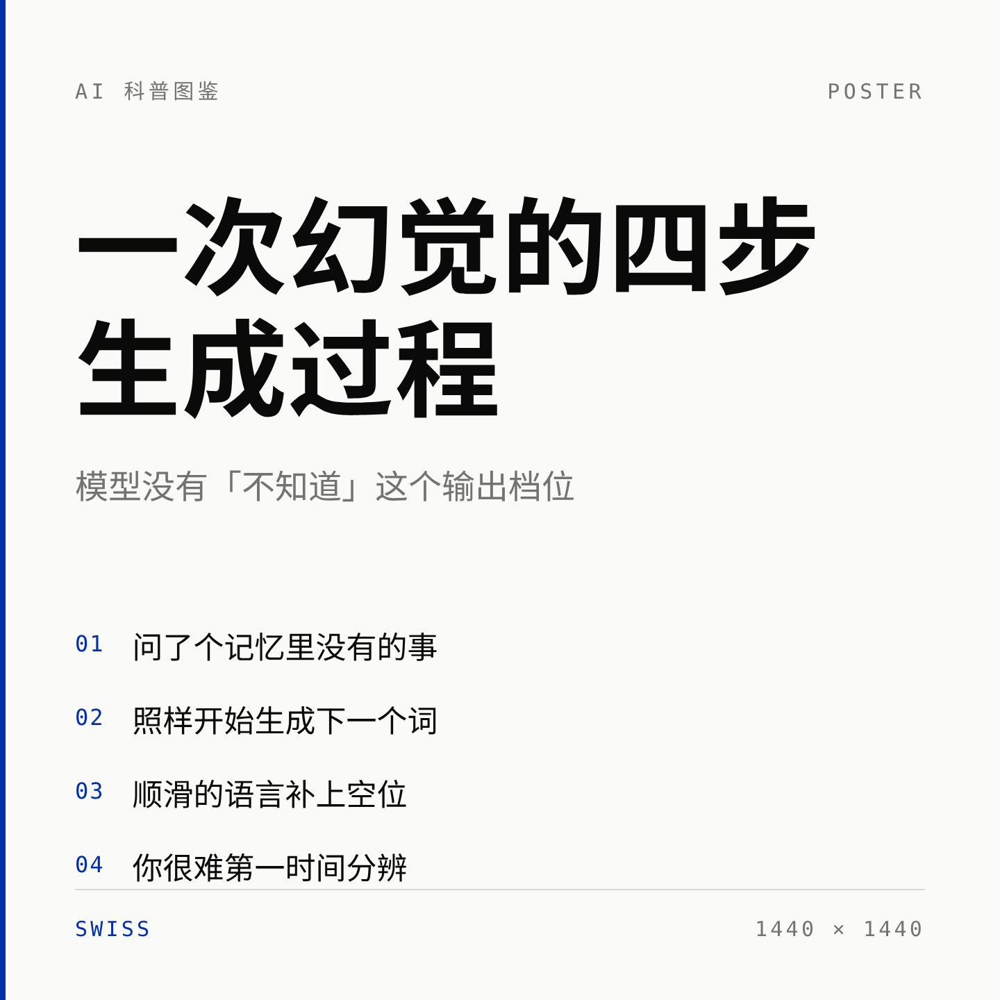

# AI 科普图文创作 · 纯代码渲染方案实测

> 目标：找到**不依赖任何图像生成 API / 模型接口**、只靠代码渲染就能批量产出 AI 科普图文的开源方案，
> 并逐个真实跑通、留下可复现的证据。
> 进阶：把那些**需要图像 API 的项目也收录进来**，用本地生图服务替换掉它的云端后端。
>
> 检索时间：2026-10-13 · 数据源：GitHub Search API + skillsmp / awesome-skills 等 skill 市场索引

---

## 📍 图片都在哪（第 1 节回答这个问题）

**全部在仓库的 `runs/` 目录下，按项目分了 6 个子目录。** 一共 **21 张 PNG**。

| 目录 | 图 | 说明 |
|---|---|---|
| `runs/01-baoyu-diagram/` | `rag@2x.png`（2340×1120）<br>`rag.svg` | 深色科技风系统流程图 |
| `runs/02-guizang/` | `xhs-01-cover.png`（2160×2880）<br>`xhs-02-pipeline.png`（2160×2880） | 小红书 3:4 卡片组 |
| `runs/03-documd/figures/` | `article-01-infographic.png`<br>`article-02-infographic.png`<br>`article-03-echarts.png`<br>`article-04-infographic.png` | 长文里的 4 张配图 |
| `runs/03-documd/` | `article-full.jpg`（整篇长图）<br>`article.html`（图文一体） | 一篇完整科普长文 |
| `runs/04-qiaomu/` | `info-card.png`（1200×2626）<br>`info-card-1/2/3.png` | 信息卡 + 自动分页的 3 张 |
| `runs/05-diagram-design/` | `attention.png`<br>`attention.svg` | 编辑级排版 + 独立矢量图 |
| `runs/06-local-imagegen/` | `01-cover` `02-steps` `03-xhs-34` `04-wide` `05-via-gemini` `06-via-dashscope` `07-via-edits` | **本地生图服务产出**（见第五节） |
| `runs/06-local-imagegen/gallery/` | 同上，服务侧命名 | 服务端出图记录 |

每个目录里都还有一份 `README.md`，写明「用了它哪套规范、踩了什么坑」。

浏览方式：GitHub 上直接点开目录即可；本地的 `README.md` 里也用相对路径引了图。

---

## 一、结论速览

### A. 纯代码渲染（零 API，首选）

| # | 项目 | ⭐ | 最近提交 | 渲染方式 | 实测结论 |
|---|------|---|---------|---------|---------|
| 1 | [cathrynlavery/diagram-design](https://github.com/cathrynlavery/diagram-design) | 53.7k | 2026-10-13 | 自包含 HTML + 内联 SVG | ✅ **最推荐**，编辑级质感，45 种图型 |
| 2 | [JimLiu/baoyu-skills](https://github.com/JimLiu/baoyu-skills) | 26.6k | 2026-09-10 | 手写 SVG → sharp 转 PNG | ✅ 深色科技风，自带转换脚本 |
| 3 | [markdown-viewer/skills](https://github.com/markdown-viewer/skills) | 3.4k | 2026-10-05 | Markdown 围栏 → infographic / echarts | ✅ 最适合批量生产长文配图 |
| 4 | [op7418/guizang-social-card-skill](https://github.com/op7418/guizang-social-card-skill) | 7.5k | 2026-07-01 ⚠️ | HTML + CSS（Swiss / 杂志两套系统） | ✅ 小红书 3:4 卡片最成熟 |
| 5 | [joeseesun/qiaomu-info-card-designer](https://github.com/joeseesun/qiaomu-info-card-designer) | 272 | 2026-10-13 | HTML → 截图 → 智能分页 | ✅ 单张信息卡 + 自动切长图 |

### B. 需要图像 API 的项目 —— 已收录，并用本地服务替换掉后端

| # | 项目 | ⭐ | 原来调什么 | 替换成什么 | 实测结论 |
|---|------|---|-----------|-----------|---------|
| 6 | `baoyu-skills` 的 **API 类技能链路**<br>（`baoyu-image-gen`） | 26.6k | codex-imagegen / OpenAI / Gemini / DashScope 等 12 家 | `localimage/` 本地生图服务 | ✅ **契约级替换，技能代码零改动**，单张 0.5–0.9s |

> 这条链路的技能（`baoyu-xhs-images`、`baoyu-infographic`、`baoyu-cover-image`）**不只是「可以」用图像 API**，
> 而是 SKILL.md 里明令**禁止**用 SVG/HTML 顶替光栅图。所以正确的替换点是**后端而不是技能层**——
> 见第五节。

> ⚠️ **一处需要说明**：`guizang-social-card-skill` 最近一次提交是 2026-07-01，
> 比「近 3 个月」的窗口（≥ 2026-07-13）早约两周。其余项目均在窗口内。

---

## 二、被排除的候选

| 项目 | 为什么不选 |
|---|---|
| `ziguishian/MxPage`、`chubbyguan/chubbyskills`、`jogholy/xhs-publisher` | 需要自备模型 API Key / 依赖浏览器自动化发布，且没有可替换的标准后端 |
| `ziguishian/xhs-visual-director-skill`、`wenziai/wenzi-xiaohongshu-workflow` | 是「选题 + 提示词 + 视觉方案」的规划型 skill，本身不渲染图片 |
| `op7418/guizang-social-card-skill` 的 Live Photo 功能 | 该子功能需要用户自备视频素材 |
| `fxyadela/write-then-publish` | 窗口内（10-04）且功能对口，但它是交互式 Web 应用，导出要登录云服务，无法端到端验证 |

---

## 三、沙箱环境攻坚（这是本次最大的坑）

目标环境是一个**极简 Linux 容器**，开箱状态下和「浏览器渲染」这个词毫无关系：

| 缺什么 | 影响 | 解决方式 |
|---|---|---|
| 没有任何浏览器 | HTML → PNG 无从谈起 | npm 包 `@sparticuz/chromium` 把静态 Chromium 打进 tarball，从 registry.npmjs.org 直接取 |
| 缺 `libnspr4` / `libnss3` 等一堆 `.so` | Chromium 启动即 `error while loading shared libraries` | npm 包 `@achingbrain/nss` 打包了 `libnspr4.so`、`libnss3.so`…；`chrome-aws-lambda` 的 `bin/aws.tar.br` 里还有 Amazon Linux 版的 nss/sqlite/expat。两处凑齐 |
| **一个中文字体都没有** | 中文全部渲染成空白方块 | 从 `notofonts/noto-cjk` 做**稀疏检出**，只拉 `Sans/SubsetOTF/SC` 与 `Serif/SubsetOTF/SC`（每字重 ~8MB），放进 `~/.fonts`（在 `/etc/fonts/fonts.conf` 的默认扫描路径里） |
| 没有 `fc-cache` / `apt` 不可用 | 字体缓存无法刷新 | 不需要——fontconfig 会自行扫描 `~/.fonts` 并写缓存 |
| 系统 `ldconfig` 缓存为空 | 误判「库不存在」 | 用 `find` 直接查 `/usr/lib/x86_64-linux-gnu` |

一键重建环境：

```bash
bash setup/render-env.sh
# 产出： /tmp/render-env/{chromium,lib/*.so,node_modules}  +  ~/.fonts/NotoSansSC-*.otf
export LD_LIBRARY_PATH=/tmp/render-env/lib:$LD_LIBRARY_PATH
node setup/shot.mjs --selftest     # 自检，会渲染一张中文测试图
```

---

## 四、五个纯代码 Run 的实测产出

### Run 1 · baoyu-diagram — 深色科技风系统图


- **按项目规范手写 SVG**：`#0f172a` 底 + 40px 网格、语义色板、**"先画线 → 再画不透明遮罩 → 最后画组件"** 的层级技巧
- **用项目自带的 `scripts/main.ts` 转 PNG**（源码零改动，用 `tsx` 执行），走 sharp/librsvg

### Run 2 · guizang — 小红书 3:4 卡片组

 

- 严格套用 **Swiss International** 系统：`1080×1440`、安全边距 72–96px、**"越大越轻"** 的字重映射
- 布局配方：封面 `S01 Accent Cover`，内页 `S06 Pipeline`
- 原模板从 Google Fonts / unpkg 取资源，沙箱不可达 → 全部本地化（唯一必要的偏离）

### Run 3 · documd — Markdown 围栏直接出图




- 一篇 Markdown 里同时用 ```` ```infographic ````（AntV Infographic，113 个模板）和 ```` ```echarts ````
- `npx documd article.md --assets ./figures --chrome /tmp/chromium` 一条命令导出全部

### Run 4 · qiaomu — 杂志质感信息卡 + 自动分页


- 套用 `600px` 卡片规范（2x 截图 = 1200px，手机上近 1:1）、完整的字号表
- **用项目自带的 `scripts/split_card.py` 把长图在自然断点切成 3 张**（找「整行都是背景色」的空白带）

### Run 5 · diagram-design — 编辑级 SVG（最高星项目）



- 用它的 **token 层**（而非硬编 hex）、尺寸取 `doc-inline` 预设 `0 0 960 600`（坐标都能被 4 整除）
- `accent` 只用在 1–2 个焦点节点；**用项目自带的 `scripts/export_svg.py` 导出独立矢量图**

---

## 五、Run 6 · 把 API 类项目也收录：用本地服务替换掉云端生图

### 为什么不能在技能层直接换

`baoyu-xhs-images` 的 SKILL.md 有一条硬规则：

> ⛔ **Never substitute SVG, HTML, canvas, or other code-based rendering for raster image generation.**
> If you cannot resolve a raster backend, ask the user — do **not** silently emit SVG.

所以不能在技能层把出图偷偷换成 HTML 截图。**正确的替换点是后端**。

### 做法：实现 API 契约，换掉实现

`localimage/` 是一个本地 HTTP 服务，它实现了 **三种真实图像 API 的线上契约**，
但出图不走云端模型，而是本机 Chromium 把提示词编译成排版设计图：

| 端点 | 模拟谁 |
|---|---|
| `POST /v1/images/generations` | OpenAI Images API |
| `POST /v1/images/edits` | OpenAI 图片编辑（multipart） |
| `POST /v1beta/models/<m>:generateContent` | Google Gemini |
| `POST /api/v1/services/aigc/multimodal-generation/generation` | 阿里云 DashScope（通义万相） |
| `POST /v1/chat/completions` | OpenAI Chat（图片走 content） |

尺寸写法各家不同，统一兼容：`1024x1024` / `1024*1024`（DashScope）/ `1K` `2K` `4K`（Gemini）。

### 实测：技能代码一行没改

```bash
node localimage/server.mjs --port 7860 &

# baoyu-image-gen 原样调用，只是 base_url 指向本地
export OPENAI_BASE_URL=http://127.0.0.1:7860/v1 OPENAI_API_KEY=local
cd projects/baoyu-skills/skills/baoyu-image-gen
npx -y tsx scripts/main.ts --provider openai --model gpt-image-2.5-flare \
  --promptfiles .../prompts/01-cover-hallucination.md \
  --image .../01-cover.png --size 1024x1024
# → /home/user/image/runs/06-local-imagegen/01-cover.png   (1024×1024 ✓)
```

| 链路 | 命令 | 产出 |
|---|---|---|
| 单图 · openai | `--provider openai` | 1024×1024 ✓ |
| 批量 · 3 任务并发 | `--batchfile batch.json --jobs 3` | Succeeded: 3 / Failed: 0 ✓ |
| Gemini 形状 | `--provider google` | 1440×1440（2K）✓ |
| DashScope 形状 | `--provider dashscope --size 1024*1024` | 1024×1024 ✓ |
| 官方 OpenAI SDK | `openai` npm 包 | `b64_json` 正常解码 ✓ |
| 改图 · multipart | `POST /v1/images/edits` | 1920×2118 ✓ |

**单张 0.5–0.9 秒、零网络请求、零 API Key。**

  

### 四类提示词都能出图

| 风格关键词 | 识别到的主题 | 效果 |
|---|---|---|
| 杂志 / 编辑风 / 暖色 | `editorial` | 奶油底 + 衬线大字 + 砖红强调 |
| neon / 赛博 / 霓虹 | `neon` | 深蓝底 + 网格 + 光晕 + 青色强调 |
| 黑板 / 粉笔 | `chalkboard` | 墨绿黑板 + 米白字 + 暖黄强调 |
| 极简 / 留白 | `minimal` | 纯白 + 极细字重 |

### 能力边界

| ✅ 能做 | ❌ 不能做 |
|---|---|
| 出**排版设计图**：大标题 + 副标题 + 要点 + 品牌页脚 | **画插画 / 场景 / 人物**——本地没有扩散模型，提示词里的画面描述不会变成画面 |
| 精确控制图上每一个字 | 输出「照片感 / 写实感」 |
| 确定性出图：同提示词同结果，适合进 CI | 需要每次都不一样的创意发散 |
| `/images/edits`：保留参考图画面 + 叠一层文案 | 真·inpainting（擦除 / 局部重绘） |

细节与全部踩坑记录见 [`localimage/README.md`](localimage/README.md) 和
[`runs/06-local-imagegen/README.md`](runs/06-local-imagegen/README.md)。

---

## 六、怎么选

| 你的场景 | 用哪个 |
|---|---|
| 要**一张能发公众号 / 博客的技术解释图**，追求质感 | `diagram-design` |
| 要**一整套小红书轮播**（封面 + 内页 + 统一视觉） | `guizang-social-card-skill` |
| 要**给长文批量配图**，图和文一起版本管理 | `markdown-viewer/skills`（documd） |
| 要**单张高信息密度信息卡**，还要自动切长图 | `qiaomu-info-card-designer` |
| 要**深色科技风的系统 / 流程 / 架构图** | `baoyu-diagram` |
| **手上有个必须调图像 API 的技能**，但没 Key / 不想付费 / 要离线 | `localimage/` 把 base_url 指过去 |

**组合打法**：
`diagram-design` 出主视觉 → `documd` 出文中所有配图 → `guizang` 出社交投放版 →
`localimage` 让任意 API 类技能离线可跑。全都是 HTML/Markdown 源码形态，天然适合进 Git 与 CI。

---

## 七、备选清单（发布时可选）

| 项目 | ⭐ | 最近提交 | 说明 |
|---|---|---|---|
| `pangxiaobin/MarkCardStudio` | 306 | 2026-08-30 | Vue3 + Tauri 桌面端，Markdown → 卡片/PDF，16 套主题 + KaTeX + Mermaid。窗口内，但纯代码渲染，不需要 API |
| `dososo/blcaptain-style-skill` | 167 | 2026-07-08 | 中文图文卡片 skill，3 套视觉语言，略超窗口 |
| `geekfoxcharlie/XHS-TextCard` | 107 | 2026-08-11 | 小红书文字卡片工具，窗口内 |
| `fxyadela/write-then-publish` | 569 | 2026-10-04 | 本地优先中文排版，窗口内，但导出链路需登录云服务 |

---

## 八、目录结构

```
├── README.md                 ← 你在这里
├── setup/
│   ├── render-env.sh         一键重建「无浏览器 / 无中文字体」环境
│   └── shot.mjs              通用 HTML → PNG 渲染器（可被 localimage 复用）
├── runs/                     ★ 所有产出图片都在这里
│   ├── 01-baoyu-diagram/     深色科技风 SVG
│   ├── 02-guizang/           小红书 3:4 卡片组
│   ├── 03-documd/            长文 + 4 张配图 + 长图
│   ├── 04-qiaomu/            信息卡 + 自动分页
│   ├── 05-diagram-design/    编辑级排版 + 矢量图
│   └── 06-local-imagegen/    本地生图服务产出（替换图像 API）
├── localimage/               ★ 本地生图服务（实现 3 种真实 API 契约）
│   ├── server.mjs            HTTP 服务与契约适配层
│   ├── render.mjs            提示词 → 设计图的编译器（14 主题）
│   └── edit.mjs              改图路径（保留画面 + 叠文案）
└── projects/                 精简搬运的上游项目源码（见 projects/README.md 的许可说明）
```

---

## 九、版权

`projects/` 下是上游项目的**精简副本**（去掉大体积截图与演示资源，保留源码、规范与许可证），
版权归各原作者所有，许可证详见 [`projects/README.md`](projects/README.md)：

- diagram-design — MIT · baoyu-skills — MIT · qiaomu-info-card-designer — MIT
- guizang-social-card-skill — AGPL-3.0 · markdown-viewer/skills — CC-BY-4.0

`setup/`、`localimage/` 与 `runs/` 为本次实测产物，可自由取用。
